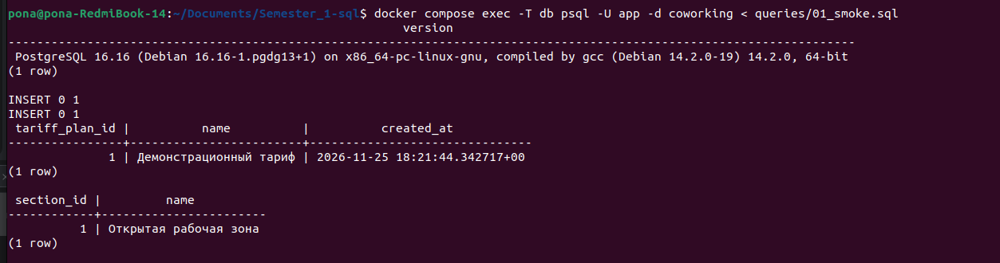
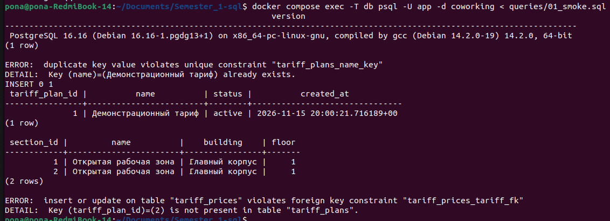

# Выбор СУБД

| Критерий | PostgreSQL | MySQL | Oracle |
|---|---|---|---|
| Модель данных и поддержка JSONB |  Реляционная модель данных. Json формат хранится в типе данных JSONB формате в бинарном представлении. | Реляционная модель данных. Json формат хранится в типе данных JSON в бинарном представлении. |  Реляционная модель данных. Json формат хранится в типе данных JSON в бинарном представлении начиная с версии Oracle 21; для более ранних версий СУБД JSON хранился в VARCHAR2 или CLOB. |
| Транзакции и уровни изоляции (MVCC) |  - Уровень изоляции по-умолчанию - Read Committed<br/> - Доступные уровни изоляции: Read Committed, Repeatable read, Serializable, изоляция Read Uncommitted работает по аналогии с Read Committed  | - Уровень изоляции по-умолчанию - Repetable Read<br/> - Доступные уровни изоляции: Read Committed, Repeatable read, Serializable,  Read Uncommitted |  - Уровень изоляции по-умолчанию - Read Committed<br/> - Доступные уровни изоляции: Read Committed, Serializable, Read Only|
| Ограничения целостности (FK, CHECK, exclusion) |  Есть FK, CHECK, EXCLUDE| Есть FK, CHECK, EXCLUDE|  Есть FK, CHECK, функциональность EXCLUDE выполняет ASSERTION|
| RLS и безопасность |  Есть встроенный RLS - реализуется через создание политик. Есть возможность выдавать пользователям роли, настраивать права доступа к схемам, таблицам и столбцам. Допускается шифрование соединение с помощью TLS.| Нет встроенных политик RLS. Есть возможность выдавать пользователям роли, настраивать права доступа к схемам, таблицам и столбцам. Допускается шифрование соединение с помощью TLS. |  Есть встроенный RLS - реализуется через написание функций PL/SQL. Есть возможность выдавать роли, ограничение на просмотр отдельных столбцов достигается засчет использования представлений. Допускается шифрование соединение с помощью TLS. |
| Экосистема и инструменты (EXPLAIN, pg_stat_statements) |  - анализ выполнения запросов выполняется с помощью EXPLAIN, EXPLAIN ANALIZE<br/> - статистика нагрузки собирается с помощью расширения pg_stat_statements| - анализ выполнения запросов выполняется с помощью EXPLAIN, EXPLAIN ANALIZE<br/> - статистика нагрузки собирается с помощью Performance Schema|  - анализ выполнения запросов выполняется с помощью EXPLAIN PLAN<br/> - статистика нагрузки собирается с помощью V$SQL, V$SQLSTATS|
| Стоимость / облако |  Бесплатная СУБД. Облаки - Amazon RDS, Google cloud SQL.| Community версия доступна бесплатно, Enterprise версия доступна платно. Облаки Amazon PDS. Google Cloud SQL.|  Oracle Ai Database Free версия бесплатная с ограничениями ресурсов; также имеются коммерческие варианты. Облаки Oracle Autonomous Ai Database, Amazon RDS for Oracle.|

Таким образом, для данной работы целесообразно выбрать СУБД PostgreSQL по следующим причинам:
1. бесплатная стоимость и поддержка в крупным облачных провайдерах
2. при помощи механизма EXCLUDE можно задавать сложные правила на данные в создаваемых таблицах, например, с помощью EXCLUDE можно задать ограничение на существование двух назначений тарифного плана для одного места в коворкинге с пересекающимися периодами
3. при помощи встроенного механизма доступа к данным построчно (RLS) можно задавать ограничение на область видимости информации о бронировании для клиентов
4. при помощи механизма настройки доступа к столбцам таблиц можно разграничивать доступ к чувствительной информации (паролям) для пользователей, не выделяя эту информацию в отдельную таблицу и не создавая новых представлений для их исключения (представления необходимо постоянно обновлять)
5. доступен широкий выбор видов изоляций для транзакций, с помощью которых можно настроить параллельное бронирование и изменение тарифного плана

# SQL vs NoSQL 
**Сценарий:** Назначение тарифного плана местам или секциям коворкинга

**Какие запросы нужны:**
- получение информации о тарифном плане с использованием различных фильтров
- получение информации о местах в коворкинге с использованием различных фильтров
- вставка новой записи в историю назначения тарифных планов местам в коворкинге (constraint, exclude отвечают за поддержку целостности данных, поэтому дополнительных запросов для проверки существования пересечения тарифного плана с каким-либо другим тарифным планом не требуется)

**Нужны ли JOIN:** да, при вставке записи в историю назначения тарифных планов местам в коворкинге требуется сделать запрос в таблицу с тарифными планами и в таблицу с местами коворкинга для получения необходимых идентификаторов.

**Нужны ли транзакции:** да, при назначении тарифного плана нескольким местам или секциям необходимо сохранить внесенные изменения, либо не сохранить ничего. 

**Как будет выглядеть схема в каждом варианте:** в реляционной модели информация о тарифных планах, местах бронирования и назначения тарифных планов местам хранятся в трех таблицах, связанных между собой внешними ключами, например rate_plan_id, coworking_space_id, tariff_assignment_id. В документной модели информацию о местах в коворкинге и назначения им тарифных планов можно хранить вложенными массивами:
```json
{
  "_id": "place_1",
  "name": "A-101",
  "section_id": "section_1",
  "tariff_assignments": [
    {
      "assignment_id": "assignment_1",
      "tariff_id": "tariff_1",
      "starts_at": "2026-12-01T00:00:00+03:00",
      "ends_at": "2027-01-01T00:00:00+03:00",
      "assigned_by": "user_7"
    }
  ]
}
```
При назначении тарифного плана секции или нескольким местам в коворкинге необходимо изменить N документов в документной модели и N строк в реляционной модели.

**Вывод:** для проектирования системы по бронированию мест в коворкинге предпочтительнее использовать реляционную модель базы данных, поскольку такой тип моделей позволяет поддерживать большое количество связей между сущностями и контролировать ссылочную целостность "из коробки", что, к примеру, требуется в части управления связями между тарифными планами и их назначениями местам и секциям в коворкинге. Подобное поведение в реляционных СУБД реализуется засчет применения внешних ключей, а в документных баз данных содержится в логике приложения.

# Smoke-тест
Успешный тест:



Повторный тест с некорректным внешним ключом:



# Ключи
Рассмотрим сущности пользователь и места в коворкинге. 

| Таблица | Суррогатный ключ | Естественный ключ | Почему выбран такой суррогатный ключ |Что будет при использовании и изменении естественного ключа: влияние на FK и индексы |
|---|---|---|---|---|
| users| user_id | login (при условии что не изменяется)| user_id является уникальным непустым неизменяемым числовым значением| Никак, индексы построятся по суррогатному ключу.|
| coworking_places| place_id | name (при условии что не изменяется) + section_id| place_id является уникальным непустым неизменяемым числовым значением| Никак, индексы построятся по суррогатному ключу.|

# Декларация использования ИИ
С помощью ИИ:
1. Лабораторная работа №1
   * Поиск информации об особенностях реализации критериев сравнения различных СУБД, а также сравнение sql/noSQL
   * Первоначальная генерация [init.sql](init.sql) по описанию кейса
   * Внесение изменений в [requirements.md](docs/requirements.md) после финального прочтения и выделения основных недочетов
2. Лабораторная работа №2
   * генерация er-диаграммы по требованиям из [requirements.md](docs/requirements.md)
   * генерация [schema.sql](schema.sql) по er-диаграмме [er.dbml](er.dbml)
   * написание тестов [queries/02_constraints.sql](queries/02_constraints.sql)

Самостоятельно:
1. Лабораторная работа №1
   * Анализ предоставленной информации, решение поставленного задания
   * Ревью и исправление сгенерированного частичного решения
   * Описание сценариев использования системы, ролей и связей сущностей с их характеристиками
   * Запуск докер-контейнера, запуск smoke теста
2. Лабораторная работа №2
   * проверка диаграммы, повторная проверка требований [requirements.md](docs/requirements.md)
   * проверка сгенерированной схемы, внесение изменений в требования [requirements.md](docs/requirements.md)
   * проверка на полноту тестов